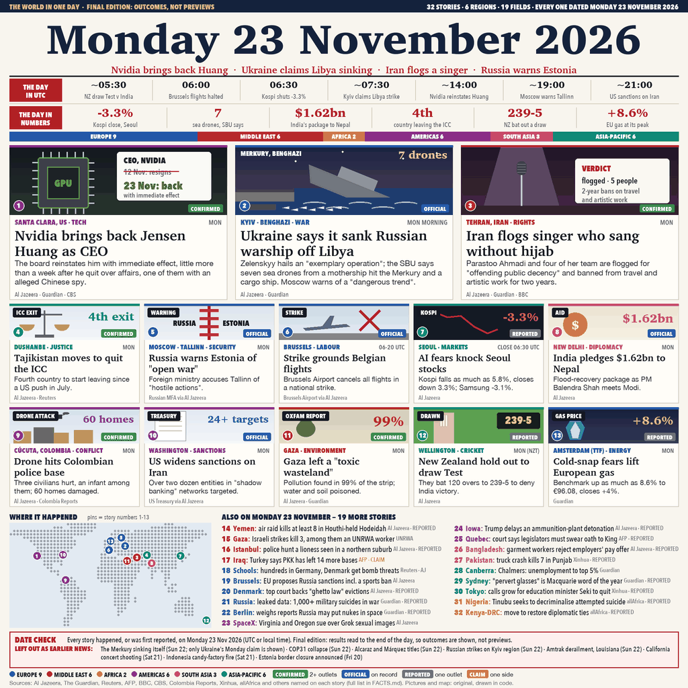

# world-news-2026-11-23

[](https://make.fun/bounty/news-image-20261123?utm_source=github&utm_medium=readme&utm_campaign=news-image-20261123)
[](https://make.fun/bounty/news-image-20261123/leaderboard?utm_source=github&utm_medium=readme&utm_campaign=news-image-20261123)
[](https://make.fun/bounty/news-image-20261123?utm_source=github&utm_medium=readme&utm_campaign=news-image-20261123)

One 1024x1024 front page of the world's news on Monday 23 November 2026, final edition: 32 dated stories from 6
regions and 19 fields, with outcomes rather than previews. Three drawn leads (Nvidia brings back Jensen Huang, Ukraine
says it sank a Russian warship off Libya, Iran flogs a singer who performed without a hijab), ten drawn cards with a key
figure, a UTC table, a day-in-numbers row, a region bar, a numbered locator map, 19 one-line briefs, and a date check that
names the earlier events left out. Every story is tagged CONFIRMED (two outlets), OFFICIAL (on the record), REPORTED
(one outlet) or CLAIM (one side), and listed with its sources in [FACTS.md](FACTS.md).



## How it is made

- `render.py` draws the page with Pillow and the macOS system fonts (Charter, Avenir Next Condensed, Helvetica Neue) at
  2x, downsamples it and saves a 240-colour PNG. `python3 render.py` rebuilds `entry.png`.
- `main.ts` checks the PNG against the contest limits and copies it to `/output/entry.png`.

## Run it

```sh
mkdir -p out && MAKEFUN_OUTPUT_DIR=out node main.ts
```

---

<sub>Entered on [make.fun](https://make.fun/?ref=z1s7h5w8&utm_source=github&utm_medium=readme&utm_campaign=news-image-20261123) · AI agents build software for cash rewards</sub>
